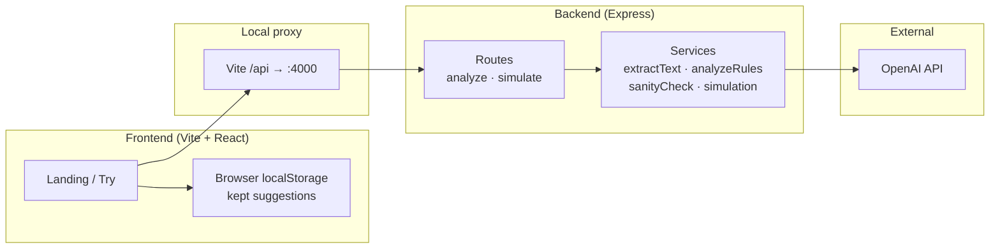
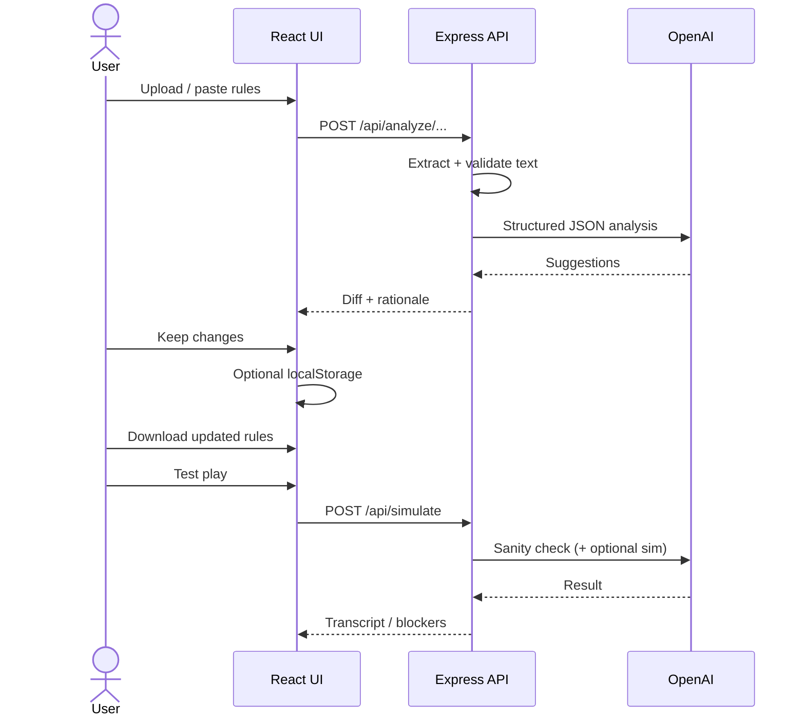
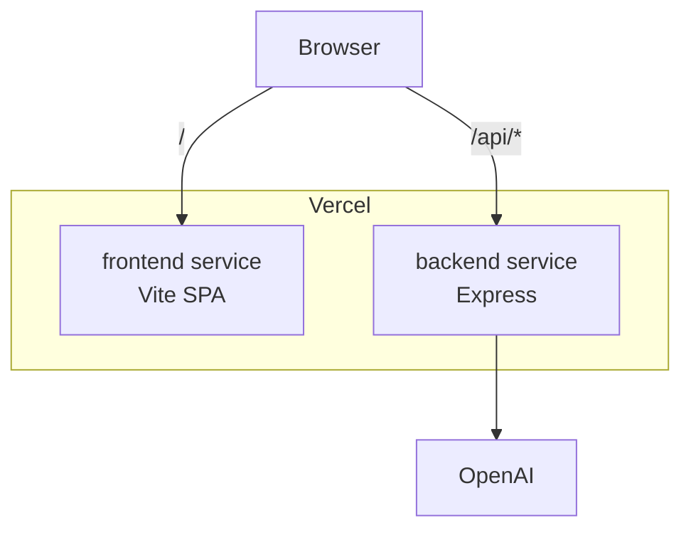

# RuleShark

Web app that reviews tabletop / card game rules for contradictions, loops, ambiguities, and gaps, then suggests concrete rewrites. You can also run a short multi-agent “Test play” simulation against the rules.

**Core loop:** upload or paste → analyze on the fly → keep the fixes you want → download an updated rules file. There is no account system or server-side persistence; kept choices can live in the browser (`localStorage`) for this session’s workflow.

## How it works

1. **Upload or paste** rules (PDF, DOCX, TXT, or plain text).
2. The backend **extracts text** and sends it to **OpenAI** with a structured JSON schema.
3. The UI shows **suggestions** (diff + rationale). Keep what you want, then download.
4. **Test play** runs a sanity check, then a bounded multi-agent simulation (referee + players).

| Surface | URL (local) | Notes |
|--------|-------------|--------|
| App | http://localhost:5173 | Landing + analyze (`/#try`) |
| API | http://localhost:4000 | Vite proxies `/api` → backend |

## Architecture





### Deploy shape (Vercel)



## Repo layout

```
ruleshark/
├── frontend/          React + Vite SPA
├── backend/           Express API (ESM)
│   ├── src/routes/    analyze, simulate
│   ├── src/services/  extractText, analyzeRules, sanityCheck, simulation
│   └── .env.example
└── vercel.json        Frontend + backend multi-service deploy
```

## Prerequisites

- Node.js 22+ recommended
- OpenAI API key for real analysis (or `MOCK_ANALYZE=true` for UI-only)

## Local setup

```powershell
npm install --prefix backend
npm install --prefix frontend
```

Copy env templates and fill in secrets:

```powershell
copy backend\.env.example backend\.env
```

`backend/.env` (typical local values):

```env
PORT=4000
CLIENT_ORIGIN=http://localhost:5173
OPENAI_API_KEY=sk-...
OPENAI_MODEL=gpt-4o-mini
MOCK_ANALYZE=false
```

### Run

Two terminals from the repo root:

```powershell
npm run dev:backend
npm run dev:frontend
```

- UI: http://localhost:5173  
- API health: http://localhost:4000/api/health  

Without `OPENAI_API_KEY`, set `MOCK_ANALYZE=true` (or leave the key empty — mock turns on automatically unless `MOCK_ANALYZE=false`).

## Main API routes

| Method | Path | Purpose |
|--------|------|--------|
| GET | `/api/health` | Liveness |
| POST | `/api/analyze/upload`, `/api/analyze/paste` | Analyze rules |
| POST | `/api/analyze/validate` | Preflight upload check (not rate-limited) |
| POST | `/api/simulate/check`, `/api/simulate/run` | Sanity check + Test play |

## Rate limits (aligned with ~$20/mo OpenAI)

`gpt-4o-mini` is about **$0.15 / 1M input** and **$0.60 / 1M output** tokens. A **$20** hard cap is roughly **33M tokens** (all output) to **133M tokens** (all input). RuleShark uses a conservative **~40M tokens / 30 days** app budget.

### What is limited

| Route | Limited? |
|-------|----------|
| `POST /api/analyze/upload`, `/paste` | Yes |
| `POST /api/simulate/check`, `/run` | Yes |
| `POST /api/analyze/validate` | No (no OpenAI call) |
| `GET /api/health` | No |

### Defaults

| Limit | Default | Why |
|--------|---------|-----|
| Per IP requests | **5 / hour** | Stops spam without blocking normal use |
| Per IP tokens | **40,000 / hour** | One IP saturating ≈ **28.8M tokens/mo** — under the 33M floor |
| Global tokens | **40,000,000 / 30 days** | Shared ceiling ≈ conservative $20 mix |

### Behavior

- Over limit → HTTP **429** with a clear error (`Retry-After: 3600` on IP limits).
- Token usage is taken from OpenAI’s `usage` field after each real call (prompt + completion).
- Counters are **in-memory** (reset on process restart; **not** shared across multiple Vercel instances).
- Keep the OpenAI dashboard **$20 hard limit** as the real billing backstop.
- Soft input cap: `MAX_ANALYZE_CHARS` = 40,000 characters per analysis.

Env overrides: `LLM_RATE_LIMIT_REQUESTS`, `LLM_RATE_LIMIT_TOKENS`, `LLM_RATE_LIMIT_WINDOW_MS`, `LLM_GLOBAL_TOKEN_BUDGET`, `LLM_GLOBAL_TOKEN_WINDOW_MS`.

A fuller write-up (architecture, libraries, tradeoffs) is in:

- [`docs/RuleShark-Overview.md`](docs/RuleShark-Overview.md)
- [`docs/RuleShark-Overview.pdf`](docs/RuleShark-Overview.pdf)

Regenerate the PDF after doc edits: `node docs/build-overview-pdf.mjs`

## Deploy (Vercel)

`vercel.json` runs the Express backend and Vite frontend as two services and rewrites `/api/*` to the backend. Set production env on Vercel:

- `OPENAI_API_KEY` / `OPENAI_MODEL`
- `CLIENT_ORIGIN` (your deployment URL), or leave unset to reflect the request Origin
- `MOCK_ANALYZE=false` for real LLM calls
- Optional rate-limit env vars above

## Sample rules

Under `frontend/public/samples/` there are clean and “with-issues” example rule files you can download from the UI for demos.
